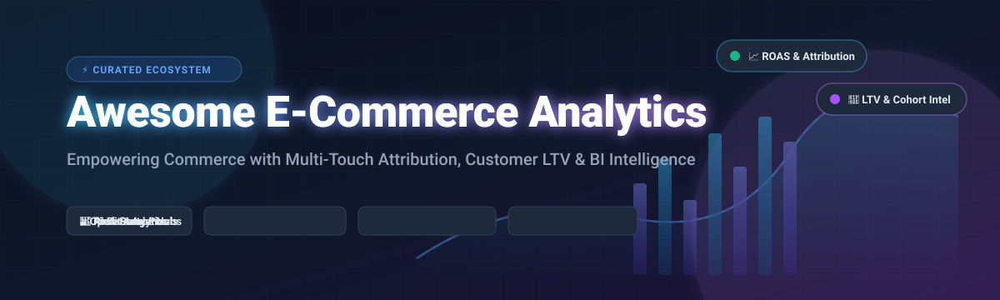

# 🛒 Awesome E-Commerce Analytics 📊

  

  
  
  
  
  
  

---

## 🌟 Overview & Ecosystem Guide

Welcome to the **Awesome E-Commerce Analytics** repository — an authoritative, SEO-optimized curated index of leading **SaaS products**, **cloud intelligence platforms**, and **open-source analytics frameworks**. 

Whether you are scaling a direct-to-consumer (DTC) store on **Shopify**, running high-volume headless commerce via **WooCommerce** or **BigCommerce**, or deploying an enterprise multi-brand data warehouse, this directory connects marketing spend, attribution pixels, unit economics, customer lifetime value (LTV), cohort retention, and margin analysis.

### 🔍 Key Topics & Search Capabilities
* **Attribution & First-Party Pixels**: Multi-touch attribution (MTA), blended ROAS, marketing mix modeling (MMM), server-side tracking (CAPI).
* **Customer Lifetime Value & Cohort Analysis**: CAC payback periods, repurchase rates, churn prediction, RFM segmentation.
* **Profitability & Unit Economics**: Real-time net margin accounting, contribution margin, real-time COGS sync, shipping/fee deduction.
* **Self-Hosted Commerce BI**: Open-source SQL modeling, warehouse-native business intelligence, privacy-first analytics, GDPR/CCPA compliance.

---

## 📈 Sector Overview & Market Dynamics

The global **E-Commerce Analytics** market is currently estimated at **$28 billion to $30 billion** (projected to reach over **$80+ billion by 2032** at an impressive **15–17% CAGR**). 

The sector is **highly fragmented**, populated by enterprise software titans (Alphabet, Adobe, Salesforce, SAP), infrastructure BI tools, and an agile layer of specialized e-commerce intelligence platforms competing on proprietary first-party pixels, multi-touch attribution (MTA), and automated customer lifetime value (LTV) cohort algorithms rather than a winner-take-all monopoly.

---

## 📑 Table of Contents
- [🛒 Awesome E-Commerce Analytics 📊](#-awesome-e-commerce-analytics-)
  - [🌟 Overview \& Ecosystem Guide](#-overview--ecosystem-guide)
    - [🔍 Key Topics \& Search Capabilities](#-key-topics--search-capabilities)
  - [📈 Sector Overview \& Market Dynamics](#-sector-overview--market-dynamics)
  - [📑 Table of Contents](#-table-of-contents)
  - [🚀 SaaS \& Hosted Analytics Platforms](#-saas--hosted-analytics-platforms)
  - [🔓 Open-Source GitHub Projects](#-open-source-github-projects)
    - [🏆 Open-Source Projects Ranked by Stargazers](#-open-source-projects-ranked-by-stargazers)
    - [💡 Architectural Evaluation: Self-Hosted vs. Turnkey SaaS](#-architectural-evaluation-self-hosted-vs-turnkey-saas)
  - [🤝 How to Contribute](#-how-to-contribute)
  - [⚖️ Disclaimer \& Privacy Considerations](#️-disclaimer--privacy-considerations)

---

## 🚀 SaaS & Hosted Analytics Platforms

The table below catalogs top SaaS and managed analytics solutions specifically designed for or heavily leveraged by modern e-commerce brands. Sorted in **descending order by company scale** (market capitalization / enterprise valuation / annual recurring revenue).

| Platform / Tool | Scale (Revenue / Valuation) | Starting Tier Pricing | Free Tier / Free Trial Limits | Key Features & Focus Areas |
| :--- | :--- | :--- | :--- | :--- |
| **[Google Analytics 4](https://analytics.google.com/)** 🌐 | **~$2.1T+ Market Cap** (Alphabet Inc. Parent) | **$0/month** (Standard GA4); 360 tier starts at **~$50,000/year** | **Free forever plan** (Subject to sampling at 10M events in Explorations, 14-month data retention, 1M events/day BigQuery export, 50 event-scoped dimensions) | Web & app event tracking, e-commerce checkout funnels, purchase events, Google Ads integration, and predictive audience building. |
| **[Shopify Reports and Analytics](https://www.shopify.com/)** 🛍️ | **~$105B+ Market Cap** (Shopify Inc., NYSE: SHOP) | **$39/month** (Basic plan, billed monthly; $29/mo billed annually) | **3-day full free trial** (No credit card required; eligible for extended promo at $1/month for first 3 months) | Native analytics dashboard with acquisition, behavior, sales conversion funnels, inventory reports, and customer loyalty segmentation. |
| **[Looker](https://looker.com/)** 🔍 | **$2.6B Acquisition** (Google Cloud Platform division) | **~$5,000/month** (Standard Platform edition billed at **~$60,000/year**) | **30-day free trial instance** (Requires sales/GCP activation; bundled with standard production instance & developer access) | Governed LookML data modeling, centralized semantic metric definitions, live database querying, and direct integration with BigQuery and Snowflake. |
| **[Mixpanel](https://mixpanel.com/)** ⚡ | **$1.05B Valuation** (~$210M ARR) | **$0/month** (Free Plan); Growth plan starting at **$0/month** up to 1M events (then ~$100–$140/mo for 1.5M events) | **Free forever plan** (Up to **1,000,000 events/month**, unlimited user seats, 10,000 session replays/mo, 10 active feature flags) | Self-serve behavioral product analytics, custom checkout drop-off funnels, user retention matrix, cohort exploration, and user journey flows. |
| **[Triple Whale](https://www.triplewhale.com/)** 🐳 | **~$300M+ Est. Valuation** (~$55.4M raised, ~$25M-$34M ARR) | **$0/month** (Permanent Free Plan); Foundation paid tier starts at **$219/month** (annual commitment) | **Free forever plan** (Includes Triple Pixel first/last-click attribution, blended ROAS dashboard, 10 users, 12-month data retention, and mobile app) | DTC single source of truth, first-party Triple Pixel, multi-touch attribution (MTA), Moby AI assistant, multi-shop dashboards, and warehouse sync. |
| **[Polar Analytics](https://www.polaranalytics.com/)** ❄️ | **$100M–$250M Est. Valuation** ($30.3M raised, ~$4.8M ARR) | **$720/month** (Core plan for stores up to $5M GMV) | **No self-serve free trial** (Available exclusively via sales demo and guided evaluation proof-of-concept) | AI-native analytics with Snowflake foundation, Ask Polar natural language queries, multi-store metrics layer, automated anomaly detection, and MCP support. |
| **[Metabase Cloud](https://www.metabase.com/)** 📊 | **~$150M+ Est. Valuation** ($43M+ raised, ~$15M ARR) | **$100/month** (Starter tier for up to 5 users; billed annually at $90/mo) | **14-day full free trial** (All cloud features active for up to 5 users without upfront commitments; free forever self-hosted AGPL tier also available) | Managed cloud BI with pre-built e-commerce dashboard templates for revenue, AOV, order volume, and cohort repeat purchase tracking. |
| **[Daasity](https://www.daasity.com/)** 🧩 | **~$60M–$80M Est. Valuation** ($20.7M raised, ~$4.5M ARR) | **$1,499/month** (Growth ELT+ tier) | **14-day free trial** (Full platform trial covering automated store ELT pipelines and data transformation modeling; no permanent free plan) | Omnichannel ELT data pipelines, pre-built e-commerce data models, drag-and-drop report builder, and reverse ETL Audiences sync to Meta and Klaviyo. |
| **[Glew.io](https://www.glew.io/)** 🏷️ | **~$35M–$45M Est. Valuation** (~$9.4M ARR, Bootstrapped) | **$250/month** (Glew Pro tier, billed annually) | **10-day to 30-day free trial** (Full access to 250+ KPI reports, 40+ integrations, and 30 pre-built customer segments) | Multichannel commerce intelligence, automated daily snapshots, subscription metrics via Recharge, inventory velocity, and customer segment profiling. |
| **[Lifetimely](https://www.lifetimely.io/)** (by AMP) ⏳ | **Undisclosed Venture / PE** (Part of AMP ecosystem) | **$0/month** (Free Plan); Basic paid tier starts at **$79/month** | **Free forever plan** (Capped at **up to 50 orders/month**, daily P&L reports, 30 days history; 14-day free trial on paid plans) | Real-time profit and net margin calculations, automated COGS and shipping deductions, predictive LTV cohort modeling, and CAC payback tracking. |

---

## 🔓 Open-Source GitHub Projects

Open-source commerce intelligence gives engineering teams full data sovereignty, zero platform markup on event volume, and custom query capabilities over their own databases and data lakes.

### 🏆 Open-Source Projects Ranked by Stargazers

The table below ranks open-source platforms and analytics engines by GitHub stars in **descending order**. Each star badge links directly to that repository's stargazers page.

| Repository | GitHub Stars Badge | License | Primary Focus & Tech Stack |
| :--- | :--- | :--- | :--- |
| **[Apache Superset](https://github.com/apache/superset)** 🐘 |  | Apache-2.0 | Enterprise-grade modern data exploration and visualization platform with 40+ visual chart types, SQL Lab IDE, semantic layer, and petabyte-scale data warehouse connectivity. |
| **[Metabase](https://github.com/metabase/metabase)** 💡 |  | AGPL-3.0 | Intuitive business intelligence tool with turn-key e-commerce dashboards (revenue, AOV, refund rate, channel split), visual query builder, and automatic email/Slack alerts. |
| **[PostHog](https://github.com/PostHog/posthog)** 🦔 |  | MIT / Elv2 | All-in-one product analytics suite with event tracking, funnel drop-off analysis, session replay recordings, user paths, A/B feature flags, and custom e-commerce telemetry. |
| **[Plausible Analytics](https://github.com/plausible/analytics)** 🍃 |  | AGPL-3.0 | Lightweight (< 1 KB script), cookie-free, privacy-first web analytics with custom event and goal conversion tracking for e-commerce checkouts and marketing attribution. |
| **[Matomo](https://github.com/matomo-org/matomo)** 🔒 |  | GPL-3.0 | The leading Google Analytics open-source alternative with dedicated E-Commerce tracking (orders, revenue, abandoned carts, SKU performance) and 100% data ownership. |
| **[Cube](https://github.com/cube-js/cube)** 🧊 |  | Apache-2.0 | Universal semantic layer for building governed e-commerce metric stores, caching layers, and headless analytics APIs across Snowflake, BigQuery, ClickHouse, and Postgres. |
| **[Snowplow](https://github.com/snowplow/snowplow)** ❄️ |  | Apache-2.0 | Enterprise-grade behavioral event data collection platform designed for high-throughput behavioral tracking across web, mobile, and server-side e-commerce applications. |
| **[OverSeek](https://github.com/MerlinStacks/overseek)** 🚢 |  | GPL-3.0 | Complete self-hosted operations and analytics hub built specifically for WooCommerce; provides real-time profit tracking, customer LTV cohorts, COGS sync, and inventory intelligence. |

---

### 💡 Architectural Evaluation: Self-Hosted vs. Turnkey SaaS

* **WooCommerce & Independent Stores**: **OverSeek** offers the closest self-hosted alternative to specialized commerce intelligence, uniting analytics, order margins, and marketing feeds into a single Docker stack.
* **Modern Data Stack (MDS)**: Pair **Cube** (for semantic metric governance) or **Metabase / Superset** with ClickHouse/Snowflake/BigQuery for full control over customized LTV formulas and multi-store reporting.
* **Pixel Attribution & Profit Sync**: Commercial platforms like **Triple Whale** and **Lifetimely** maintain deep, pre-engineered integrations with ad networks (Meta CAPI, Google Ads, TikTok Ads) and shipping carriers that require non-trivial engineering effort to recreate from scratch.

---

## 🤝 How to Contribute

We welcome contributions from merchants, data engineers, and e-commerce founders! 🚀

1. 🍴 **Fork** this repository.
2. 🌿 **Create a new branch**: `git checkout -b feature/add-new-analytics-tool`.
3. 📝 **Add or update entries**: Ensure factual accuracy, specific pricing tiers, and verifiable GitHub links.
4. 📬 **Submit a Pull Request** with a summary of the additions.

---

## ⚖️ Disclaimer & Privacy Considerations

* This repository is community-curated for informational and architectural evaluation purposes.
* E-commerce platforms handling user and financial telemetry must comply with GDPR, CCPA, and regional e-privacy directives when capturing attribution pixels and customer identities.
* Always verify software licenses (e.g., AGPL-3.0, Apache-2.0, MIT) before commercial deployment in proprietary environments.

---

  <b>Built with ❤️ for e-commerce founders, growth marketers, and data engineers worldwide.</b> 
  Star ⭐ this repo if you find it valuable!

